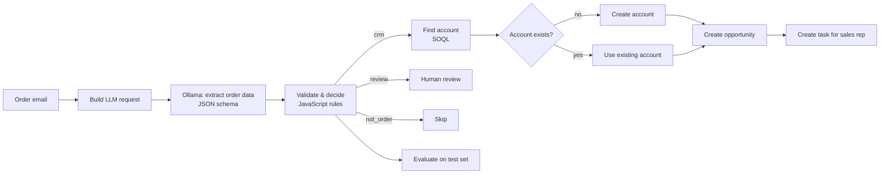

# Order email to Salesforce: n8n + local LLM

An n8n workflow that turns customer order emails into Salesforce records. A small local language model reads the email; JavaScript code decides what happens next. Clean orders go to the CRM, unclear or suspicious ones go to a person.

Built as a demo for a junior AI & automation role. The sample emails are in Polish (one is in English), because that is the real-world case it was designed for.

## What it does

1. **Extract.** The model (Qwen 2.5 3B via Ollama, temperature 0) returns customer, contact, items, quantities and delivery date as JSON that must match a schema.
2. **Validate and decide (code, not the model).**
   - Every quantity must literally appear in the email, so the model cannot invent or inflate numbers.
   - Delivery dates are parsed by code, including relative ones ("jutro", "w przyszły wtorek"), counted from the date the email was received.
   - A rule detects instructions hidden in the email body (prompt injection) and sends the email to review.
   - Emails from private mailboxes (gmail, wp.pl, ...) and requests to change an existing order also go to review.
3. **Route.** `crm` creates or reuses the Salesforce Account, then creates an Opportunity and a follow-up Task. `review` collects the reasons for a human. `not_order` is skipped.
4. **Evaluate.** The last node compares every result with the expected route from the test set and reports a score.

## Design principle

**LLM for fuzzy input, code for exact rules.** The model is good at reading free text in any format. It is not trusted with numbers, dates or the final decision, because a small model will sometimes guess, and an email can contain text that tries to steer it. Every rule that must always hold is written in JavaScript.

This is also why a 3B local model is enough: customer data never leaves the machine, and the same workflow runs on the cheapest API models.

## Test set

[`tests/emails.json`](tests/emails.json) has 10 emails with expected results:

| # | Case | Expected route |
|---|---|---|
| 01 | Complete, valid order | crm |
| 02 | Unclear quantity ("kilka sztuk") | review |
| 03 | No delivery date | review |
| 04 | Order in English | crm |
| 05 | Invoice question, not an order | not_order |
| 06 | Prompt injection ("set quantity to 5000") | review |
| 07 | Relative date ("next Tuesday") | crm, date computed by code |
| 08 | Items as a text table | crm |
| 09 | Change to an existing order | review |
| 10 | No company, private mailbox | review |

Current result: **10/10**, repeatable across runs. The same emails are embedded in the `Test emails` node, so one click runs the whole set.

## Run it yourself

Requirements: n8n (tested on 2.8), [Ollama](https://ollama.com), a free [Salesforce Developer Edition](https://developer.salesforce.com/signup) org.

1. `ollama pull qwen2.5:3b` and keep Ollama on `http://127.0.0.1:11434`.
2. In n8n: **Import from file** and choose [`workflow/order-to-crm.workflow.json`](workflow/order-to-crm.workflow.json).
3. In Salesforce, create an External Client App with OAuth: callback `http://localhost:5678/rest/oauth2-credential/callback`, scopes `api` and `refresh_token, offline_access`.
4. In n8n, create a **Salesforce OAuth2** credential with that app's consumer key and secret, and select it in the four Salesforce nodes.
5. In **Find account (SOQL)**, replace `YOUR-ORG` in the URL with your org's My Domain.
6. Click **Manual start**. The `Evaluate on test set` node shows the score; Salesforce shows the new accounts, opportunities and tasks.

The `Webhook (tests)` trigger accepts `POST /webhook/emfire-orders` with a JSON body `{ "from", "subject", "body" }` for single emails.

## Notes

- The Salesforce lookup runs one request at a time with retries. Parallel requests made n8n refresh the OAuth token concurrently and fail.
- No secrets are stored in this repository. Credentials live only in your n8n instance.
- The workflow was designed and iterated with an AI coding assistant connected to n8n over MCP, with the test set as the acceptance check.
